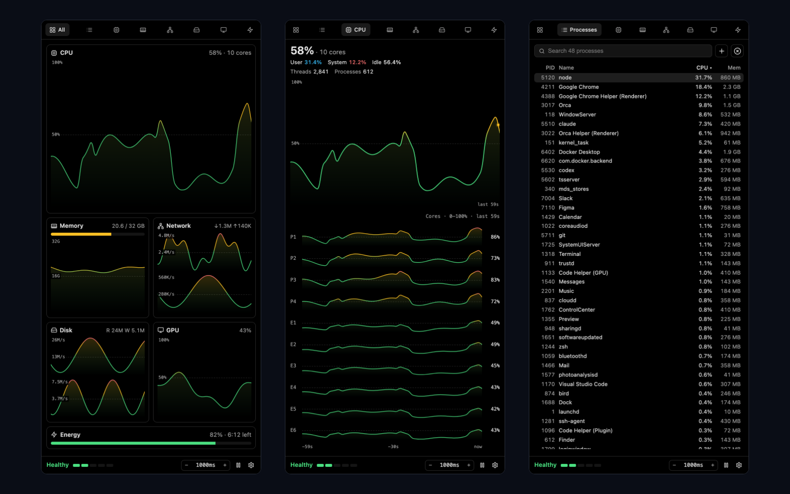

# Activity Monitor

A live system monitor in Orca's right sidebar: CPU cores, memory, network, disk, GPU and processes.



- **All** shows every section in one scroll. Each section also has its own tab, where its graphs fill the whole panel.
- **CPU** shows a bar per core on All and a graph per core on its page. Apple silicon and hybrid Intel cores are labeled P and E.
- **Processes** can be filtered and sorted, and loads more rows as you scroll, so you can reach every process. To quit one, hover its row and press ×. It asks first, and it refuses Orca itself and system processes.
- **Settings** (the gear) switches graphs between Smooth and Pixel, color between Heat and your Orca theme (Theme recolors everything, including the health strip, which ramps from your theme's primary color to its destructive color), and refresh between 1, 2 and 5 seconds.

## Lock-up warnings

The strip at the bottom of the panel shows one word on a five-step scale, with a pip per step: **Idle · Healthy · Busy · Strained · Critical**. Click it (or press Enter on it) to open a drawer that grows up from the footer with the cause and the five most likely culprits: by memory, or by CPU when Busy. Each has a **Quit** button; if an app ignores it for 3 seconds, the button becomes **Force quit**. Apps are grouped with their helper processes. Processes that share a name, like many `node`, are listed one by one so each Quit hits exactly one process. Orca and system processes are listed without a button.

- **Idle**: CPU under 10% and memory under 60%.
- **Healthy**: normal use.
- **Busy**: CPU averaging 70% or more over 10 seconds. CPU alone never raises an alert.
- **Strained**: memory pressure, memory over 90%, or swap growing. The strip turns amber.
- **Critical**: memory pressure with swap growing fast, or memory full. The strip turns red, a toast appears in the panel, a "Critical" badge shows in Orca's status bar, and a **Quit ‹app›** button names the app using the most memory, with its helper processes counted in. If memory stays critical, a desktop notification follows, so it reaches you even when Orca is in the background.
- After each toast or notification it stays quiet for 10 minutes.
- It never offers to quit Orca, its helpers, or system processes. If Orca itself is the biggest user, or several unrelated processes share one name, no Quit button appears.

The badge keeps the worker running while the sidebar is closed, so warnings still fire. It's hidden below Critical. Windows has no pressure or swap reading, so there it goes by memory percent alone.

It runs as a trusted worker because it reads system counters and lists processes, so Orca asks you to approve it on install. It makes no network connections and keeps its settings only in your copy of Orca.

## What each system shows

| | macOS | Linux | Windows |
| --- | --- | --- | --- |
| CPU per core | yes, P/E labels | yes, P/E on hybrid Intel | yes |
| Memory | app, wired, compressed, cached, swap, pressure | used, cached, swap, pressure | used |
| Network | default interface | default interface | all interfaces |
| Disk | space and read/write | space and read/write | space |
| GPU | Apple GPU | NVIDIA (`nvidia-smi`) or AMD | not shown |
| Processes | yes | yes | yes, through PowerShell |
| Energy and battery | energy impact, sleep blockers, battery | battery | battery |
| Packets and disk operations | yes | yes | packets only |

## Process columns

Click **+** next to the search box, or right-click the column headers, to add or remove columns. Drag a header to move its column. Columns that do not fit hide from the end of the order and come back when the panel is wider. Click a process to select it and hold the list in place; double-click it to see every field. Click it again or press Escape to deselect.

| Column | macOS | Linux | Windows |
| --- | --- | --- | --- |
| CPU time, threads, user | yes | yes | CPU time and threads |
| Idle wake ups, ports, energy impact, preventing sleep | yes | – | – |
| % GPU, GPU time | yes | – | – |
| Bytes read and written | – | your own processes | yes |
| Sent and received bytes | yes | – | – |

12 hr power, App Nap and Kind need admin rights on macOS and are not shown.

Sections a system cannot report are left out.

## Develop

```sh
orca plugin validate .
orca plugin dev watch .
node --test tests/*.test.mjs
```
