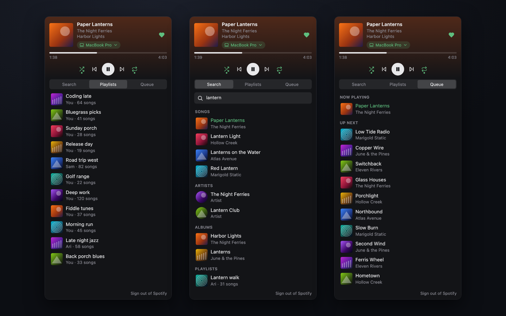

# Now Playing

Control Spotify or Apple Music from Orca's right sidebar: see what's playing, skip, seek, like songs, search your library, start any playlist and pick where it plays.

The first time you open it, pick **Spotify** or **Apple Music**. The footer shows which one you use; **Switch to …** changes it.

## Both apps

- **Player**: cover, song, artist and album, a seek bar, and shuffle, previous, play/pause, next and repeat. The heart saves the song (Liked Songs on Spotify, Favourite Songs on Apple Music). The arrow on the left opens the app; the icon on the right picks the device or speaker and sets the volume.
- **Library**: a search bar, then your library. Click a playlist, album or artist to see its songs; hover it and press play to start it.

## Spotify

**On a Mac there is nothing to set up.** The player talks to the Spotify app directly (AppleScript), so what's playing and the controls never hit Spotify's rate limit. You get the player, **DJ** and **Recently played**: the panel remembers the last 50 songs you played in the Spotify app, and plays any of them again.

**Optional: connect your Spotify account** for your Library, search, Queue, devices and likes, and to control Spotify on your phone or another computer. You need Spotify **Premium** and a free Spotify developer app of your own; the panel walks you through it. On Windows and Linux this step is needed.

1. Open [developer.spotify.com/dashboard](https://developer.spotify.com/dashboard) and click **Create app**.
2. Add the redirect URI `http://127.0.0.1:8888/callback`. It must be `127.0.0.1`, not `localhost`.
3. Tick **Web API**, accept the terms and save.
4. Copy the **Client ID** from the app's settings and paste it into the panel (or Settings → Now Playing). You never need the client secret.
5. Click **Sign in with Spotify** and press **Agree** in your browser.

Spotify only lets accounts listed on your developer app use it, so each person makes their own.

When connected, the panel saves your library about once a day (Liked Songs, playlists, albums, artists, daylist and the songs in up to 10 playlists and 10 albums). If Spotify's rate limit pauses the API, you still see, search and play that saved copy through the Mac app, and the panel shows when the API is back.

- **DJ** plays through the Spotify app on the same Mac (Spotify's Web API ignores requests to start DJ). It is hidden on Windows and Linux.
- **daylist** shows when you have played it recently: Spotify hides it from apps, but it appears in your recently played.

## Apple Music (Mac only)

Nothing to set up and nothing to sign in to: the panel talks to the Music app on your Mac.

- **Library**: Favourite Songs, Recently Added, your playlists, artists and albums, with search. Albums, artists and Favourite Songs play in order through one reusable playlist in your library, named **Now Playing (Orca)**.
- **Speakers**: your AirPlay devices, with volume.
- **Radio**: the song and cover follow what is on air. Live radio cannot skip songs.

The Music app does not let other apps see Up Next, Apple's own mixes outside your library, or the length of songs you stream but have not added, so those don't show here.

## Permissions

It runs as a trusted worker, because it waits for Spotify's sign-in on `127.0.0.1:8888`, calls the Spotify Web API and runs AppleScript. It asks for:

- **Own storage** (`storage:own`): your app choice, open tab, saved Spotify library, Recently played and Spotify's rate-limit pause.
- **Own settings** (`settings:own`): your Client ID.
- **Own secrets** (`secrets:own`): your Spotify sign-in token, in Orca's encrypted secrets file.

On a Mac it runs `osascript` to control the Spotify or Music app, and `sips` and `base64` to shrink Apple Music cover art (written to `/tmp/orca-now-playing-cover*`).

It signs in with PKCE, so there is no client secret. It talks only to `accounts.spotify.com`, `api.spotify.com`, Spotify's image hosts, and, for Apple Music radio and streamed songs, Apple's public `itunes.apple.com` search and `mzstatic.com` image hosts. **Sign out** at the bottom of the panel deletes the Spotify token.

## Limits

- Spotify does not let new developer apps list the songs of its own editorial playlists (Discover Weekly, Spotify-made mixes). Their play button still works.
- Port 8888 must be free while you sign in.
